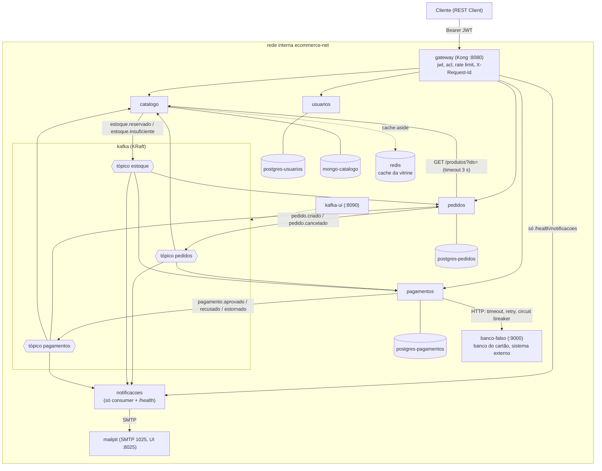

# E-Commerce - Arquitetura de Microsserviços

Repositório estruturado no modelo de **monorepo com microsserviços independentes**. Cada serviço possui sua própria stack, dependências (`package.json`), banco de dados isolado e `Dockerfile`. Nenhum serviço importa código de outro.

- **Aula 06:** `usuarios` (Postgres) e `catalogo` (MongoDB) no Docker Compose.
- **Aula 07:** API Gateway (Kong) na frente de tudo, JWT validado no gateway e o serviço `pedidos` (carrinho e checkout) consultando o catálogo.
- **Aula 08:** Kafka (KRaft) e eventos: o checkout publica, o catálogo reserva o estoque e as notificações avisam por e-mail (coreografia).
- **Aula 09:** Saga e resiliência: o serviço `pagamentos` cobra no `banco-falso` (timeout, retry e circuit breaker) e cada serviço desfaz a própria parte quando o pagamento é recusado ou o pedido é cancelado.
- **Aula 10:** Observabilidade e cache: `/health` com três estados, healthcheck no Docker, logs correlacionados por `pedidoId` e `correlationId`, cache Redis na vitrine do catálogo e subida do zero com um comando.

---

## Subir

Num clone novo, sem nenhum passo a mais (não precisa de `.env`: toda variável tem valor padrão no compose):

```bash
docker compose up -d --build
```

Sobem 15 containers: serviços, bancos, Kafka, Kong, Redis, Mailpit e banco-falso. Migrations, seeds e tópicos do Kafka se criam sozinhos: o sistema sobe **com dados**. O gateway é o último a subir (só depois de `usuarios`, `catalogo`, `pedidos`, `pagamentos` e `notificacoes` ficarem saudáveis), então, quando o comando devolve o terminal, a API está pronta. A primeira subida demora alguns minutos (build, migrations e seeds).

Conferir: `docker compose ps` deve mostrar todos os serviços `(healthy)` (o `kafka-ui` não tem healthcheck).

Do zero absoluto (apaga bancos e Kafka): `docker compose down -v && docker compose up -d --build`.

Opcional: `cp .env.example .env` para trocar o `JWT_SECRET`. Mudou o `kong/kong.yml`? `docker compose restart gateway`.

### Portas (as únicas publicadas)

| Porta | O que é |
| :--- | :--- |
| `8080` | **API da loja** (única URL usada pelos clientes) |
| `8001` | Admin API do Kong (leitura: `curl localhost:8001/routes`) |
| `8002` | Kong Manager (painel) |
| `8090` | Kafka UI (tópicos, mensagens, grupos e lag): só uso local, sem autenticação |
| `8025` | Mailpit (caixa de entrada dos e-mails de mentira): só uso local, sem autenticação |
| `9000` | banco-falso (o banco do cartão, sistema externo): `/config` para latência e falhas ao vivo e `/health`. Fora do Kong ([ADR 0009](docs/adr/0009-resiliencia-no-banco-externo-e-banco-falso-fora-do-kong.md)) |

Redis, Kafka, bancos e os serviços **não** publicam porta: só se falam pela rede interna `ecommerce-net`.

### Usuários do seed

| Perfil | E-mail | Senha |
| :--- | :--- | :--- |
| admin | `admin@loja.com` | `admin123` |
| cliente (com um endereço) | `cliente@loja.com` | `cliente123` |

### Primeira compra

Abra `http/fluxo-completo.http` no VS Code (extensão REST Client) e rode de cima para baixo: login, vitrine, carrinho, checkout (202), pedido até `PAGO` e pagamento `APROVADO`. Nada precisa ser editado. Detalhes em [Demonstração](#demonstração).

### Variáveis de ambiente (todas opcionais)

| Variável | Serviço | Padrão no compose |
| :--- | :--- | :--- |
| `JWT_SECRET` | `gateway`, `usuarios` | `supersecret_ecommerce_jwt_key_2026` (mesmo valor nos dois; não use `\|`, `&` nem `\`) |
| `REDIS_URL` | `catalogo` | `redis://redis:6379` |
| `CACHE_TTL_SEGUNDOS` | `catalogo` | `60` |

---

## Arquitetura



Os 15 containers do diagrama são os do `docker-compose.yml`: `gateway`, `usuarios`, `catalogo`, `pedidos`, `pagamentos`, `notificacoes`, `postgres-usuarios`, `mongo-catalogo`, `postgres-pedidos`, `postgres-pagamentos`, `redis`, `kafka`, `kafka-ui`, `mailpit` e `banco-falso`.

- **Gateway decide a porta:** quem é você (401) e se pode entrar na rota de admin (403).
- **Serviço decide o recurso:** este pedido/endereço é seu? (404) Ainda pode ser cancelado? (409)
- **`usuarios` é o único que emite JWT** (HS256, `{ sub, email, perfil, iss }`, vence em 2 h). Os serviços não validam token: leem os cabeçalhos `X-User-*` que o Kong injeta.
- Chamadas entre serviços são diretas pela rede interna (sem Kong, sem token), com timeout de 3 s e `x-request-id` repassado.

### Serviços

| Serviço | Banco | Acesso a dados | Responsabilidade |
| :--- | :--- | :--- | :--- |
| `gateway` | — (Kong declarativo) | `kong/kong.yml` | rotas, JWT, ACL, `X-Request-Id`, rate limit no login |
| `usuarios` | PostgreSQL 16 | Prisma 6 | cadastro, login (único emissor de JWT), endereços |
| `catalogo` | MongoDB 7 + Redis 7 (cache) | Mongoose 8, ioredis 5 | produtos, categorias, estoque, reserva de estoque (consumer), cache da vitrine |
| `pedidos` | PostgreSQL 16 | Prisma 6 | carrinho, checkout (chama o catálogo), ciclo de status do pedido (consumers) |
| `pagamentos` | PostgreSQL 16 | Prisma 6 | cobrança no banco do cartão (timeout, retry, circuit breaker), estorno |
| `notificacoes` | — | nodemailer | e-mails por evento (Mailpit); HTTP só para `/health` |
| `banco-falso` | — (memória) | — | o banco do cartão (sistema externo): latência e falhas ajustáveis em `/config` |
| `kafka` | volume `kafka_data` | — | broker único (KRaft); tópicos `pedidos`, `estoque`, `pagamentos` |
| `redis` | sem persistência | — | cache da vitrine; sem porta, sem volume |
| `mailpit`, `kafka-ui` | — | — | ferramentas locais (caixa de e-mails e painel do Kafka) |

Todos os serviços de aplicação usam Node 22, TypeScript, Express 4, Zod 3 e seguem `routes → controllers → services → repositories` ([ADR 0001](docs/adr/0001-padrao-em-camadas.md)); escutam na **porta 3000 dentro do container**.

### Estrutura do repositório

```text
usersEcommerceArq/
├── docker-compose.yml          # os 15 containers, healthchecks e depends_on com service_healthy
├── .env.example                # opcional: JWT_SECRET (e, se quiser, REDIS_URL e CACHE_TTL_SEGUNDOS)
├── kong/kong.yml               # Kong sem banco: services, routes, consumers e plugins
├── usuarios/  catalogo/  pedidos/  pagamentos/  notificacoes/  banco-falso/   # um serviço por pasta
├── docs/
│   ├── adr/                    # decisões de arquitetura (um arquivo por decisão)
│   └── features/               # spec, contrato e plano de cada entrega
├── http/
│   └── fluxo-completo.http     # a saga inteira, do login ao PAGO, e os casos de erro
└── requests/                   # um .http por serviço, mais fluxo-compra, demos e observabilidade
```

---

## Rotas

Todas pelo gateway, `http://localhost:8080`. Acesso: **público** (sem token), **logado** (jwt, 401 sem token) e **admin** (jwt + acl `allow [admin]`: 401 sem token, 403 perfil cliente). Recurso de outra pessoa devolve 404, não 403.

### Usuários
| Método | Rota | Acesso | Retornos |
| :--- | :--- | :--- | :--- |
| `POST` | `/auth/login` | público | 200 `{ token }` · rate limit 10/min por IP: 429 na 11ª tentativa |
| `POST` | `/usuarios` | público | 201 cadastro |
| `GET` · `PUT` | `/usuarios/me` | logado | 200 |
| `GET` · `POST` | `/usuarios/me/enderecos` | logado | 200 · 201 |
| `DELETE` | `/usuarios/me/enderecos/:id` | logado | 204 · 404 se o endereço não é seu |
| `GET` | `/usuarios` | admin | 200 lista (sem `senha_hash`) |

### Catálogo
| Método | Rota | Acesso | Retornos |
| :--- | :--- | :--- | :--- |
| `GET` | `/produtos?categoria=&busca=&ids=` | público | 200 lista · `X-Cache` (sem `ids`); com `ids` não usa cache |
| `GET` | `/produtos/:id` (id ou SKU) | público | 200 · 404 · `X-Cache` no 200 |
| `GET` | `/categorias` | público | 200 · `X-Cache` |
| `POST` | `/produtos` | admin | 201 |
| `PUT` | `/produtos/:id` | admin | 200 |
| `PATCH` | `/produtos/:id/estoque` | admin | 200 |
| `DELETE` | `/produtos/:id` | admin | 200 (soft delete) |
| `POST` | `/categorias` | admin | 201 |

### Pedidos
| Método | Rota | Acesso | Retornos |
| :--- | :--- | :--- | :--- |
| `GET` | `/carrinho` | logado | 200 `{ itens, total }` com preços atuais do catálogo |
| `POST` | `/carrinho/itens` | logado | 201 · 400 quantidade inválida · 404 produto não existe |
| `DELETE` | `/carrinho/itens/:produtoId` | logado | 204 · 404 não está no carrinho |
| `POST` | `/pedidos` | logado | 202 aceito (publica `pedido.criado`) · 400 carrinho vazio · 409 produto inexistente ou inativo · 503 catálogo fora |
| `GET` | `/pedidos` | logado | 200 meus pedidos (cada um com `motivo_cancelamento`, `null` se não houver) |
| `GET` | `/pedidos/:id` | logado | 200 pedido com itens (o status muda sozinho por evento) · 404 não existe ou não é meu |
| `POST` | `/pedidos/:id/cancelar` | logado | 200 cancelado (publica `pedido.cancelado`) · 404 · 409 status não permite (ex.: `PAGO`) |

Corpo do checkout (`POST /pedidos`):
```json
{
  "endereco_entrega": { "cep": "01310-100", "logradouro": "Av. Paulista", "numero": "1578", "cidade": "São Paulo", "uf": "SP" },
  "forma_pagamento": "cartao",
  "numero_cartao": "4111111111111111"
}
```
`forma_pagamento`: `cartao`, `pix` ou `boleto`. Do cartão, só os 4 últimos dígitos são gravados (`cartao_final`).

### Pagamentos
| Método | Rota | Acesso | Retornos |
| :--- | :--- | :--- | :--- |
| `GET` | `/pagamentos/:pedidoId` | logado | 200 pagamento (dono ou admin) · 404 não existe ou não é seu |
| `GET` | `/pagamentos` | admin | 200 todos · 403 perfil cliente |

O pagamento não tem rota de criação: nasce do evento `estoque.reservado`. Status: `PENDENTE` (gravado antes de chamar o banco), `APROVADO`, `RECUSADO`, `ERRO` (banco não respondeu: timeout, 5xx ou circuito aberto), `CANCELADO` (pedido cancelado antes da cobrança) e `ESTORNADO` (cobrado e devolvido).

### Health (todos públicos, sem token)
| Método | Rota | Acesso | Retornos |
| :--- | :--- | :--- | :--- |
| `GET` | `/health/usuarios` | público | 200 · 503 |
| `GET` | `/health/catalogo` | público | 200 (`ok` ou `degradado`) · 503 |
| `GET` | `/health/pedidos` | público | 200 · 503 |
| `GET` | `/health/pagamentos` | público | 200 (`ok` ou `degradado`) · 503 |
| `GET` | `/health/notificacoes` | público | 200 (`ok` ou `degradado`) · 503 |
| `GET` | `http://localhost:9000/health` | fora do Kong | 200 sempre |

### banco-falso (fora do Kong, `http://localhost:9000`)
| Método | Rota | Resposta |
| :--- | :--- | :--- |
| `POST` | `/cobrancas` `{ valor, cartaoFinal, referencia }` | 201 `{ aprovado, codigo: "TX-..." }` · 402 `{ motivo: "saldo insuficiente" }` (cartão final `0002`) · 503 com `falhaPercent`% de chance. Mesma `referencia` = mesma resposta, sem cobrar de novo |
| `POST` | `/estornos` `{ codigo, referencia }` | 201 · 404 sem cobrança aprovada. Sem latência nem falha simulada |
| `GET` · `POST` | `/config` `{ latenciaMs, falhaPercent }` | 200 config atual / nova |
| `GET` | `/health` | 200 |

### Formato de erro
Todos os serviços respondem no mesmo formato (exceto o `/health`, que sempre devolve `{ servico, status, dependencias }`):
```json
{ "erro": "Dados inválidos.", "detalhes": ["preco deve ser maior que zero", "sku é obrigatório"] }
```
Nunca vaza stack trace nem mensagem de banco; `senha_hash` nunca sai. Os erros 401, 403, 404 de rota desconhecida e 429 recusados no gateway vêm no formato do Kong (`{ "message": ... }`).

---

## Eventos

Um broker Kafka 3.8 em KRaft, só na rede interna. Um tópico por entidade (`pedidos`, `estoque` e `pagamentos`), 3 partições, fator de replicação 1. Chave de todas as mensagens: o **id do pedido** (eventos do mesmo pedido chegam em ordem).

| Evento | Tópico | Publica | Consome | `dados` |
| :--- | :--- | :--- | :--- | :--- |
| `pedido.criado` | `pedidos` | `pedidos` (depois do commit) | `catalogo`, `notificacoes` | `usuarioId`, `clienteEmail`, `valorTotal`, `formaPagamento`, `cartaoFinal`, `itens` |
| `pedido.cancelado` | `pedidos` | `pedidos` (cancelamento do cliente) | `catalogo` (devolve o estoque), `pagamentos` (estorna ou bloqueia a cobrança) | `usuarioId`, `clienteEmail`, `valorTotal`, `motivo` |
| `estoque.reservado` | `estoque` | `catalogo` | `pedidos`, `pagamentos` (cobra) | `usuarioId`, `clienteEmail`, `itens`, `valorTotal`, `formaPagamento`, `cartaoFinal` |
| `estoque.insuficiente` | `estoque` | `catalogo` | `pedidos`, `notificacoes` | `motivo`, `usuarioId`, `clienteEmail` |
| `pagamento.aprovado` | `pagamentos` | `pagamentos` | `pedidos` (→ `PAGO`), `catalogo` (confirma a reserva), `notificacoes` | `usuarioId`, `clienteEmail`, `valor`, `codigoTransacao`, `tentativas` |
| `pagamento.recusado` | `pagamentos` | `pagamentos` (recusa do banco **ou** banco fora) | `pedidos` (→ `CANCELADO` com motivo), `catalogo` (devolve o estoque), `notificacoes` | `usuarioId`, `clienteEmail`, `valor`, `motivo`, `tentativas` |
| `pagamento.estornado` | `pagamentos` | `pagamentos` (cancelado depois de cobrado) | `notificacoes` | `usuarioId`, `clienteEmail`, `valor`, `codigoTransacao` |

Envelope igual em todos os eventos:
```json
{ "id": "uuid", "tipo": "pedido.criado", "pedidoId": "uuid", "ocorridoEm": "2026-10-29T18:30:00.123Z", "correlationId": "x-request-id do Kong", "dados": { } }
```
- **Group ids:** `pedidos`, `catalogo`, `pagamentos`, `notificacoes` (um por serviço). Todos leem `fromBeginning`.
- **Entrega pelo menos uma vez:** todo consumer é idempotente. O catálogo usa `reservas.pedidoId` único e filtro de status da reserva; `pedidos` só muda o status a partir do estado esperado (`updateMany` condicional); `pagamentos` usa `pedido_id` UNIQUE.
- **Evento é contrato:** só se acrescentam campos; consumers validam só o que usam e ignoram tipos desconhecidos.
- **Sem dados sensíveis no evento:** nada de número de cartão, senha ou documento (só `cartaoFinal`).
- **`correlationId`:** o `X-Request-Id` do Kong segue de evento em evento e aparece nos logs.

### A saga (coreografia) e as compensações
| Passo (transação local) | Serviço | Compensação | Disparada por |
| :--- | :--- | :--- | :--- |
| Criar o pedido | `pedidos` | marcar `CANCELADO` com o motivo | `estoque.insuficiente`, `pagamento.recusado` |
| Reservar o estoque | `catalogo` | devolver ao disponível (`reservas.status` → `liberado`) | `pagamento.recusado`, `pedido.cancelado` |
| Cobrar | `pagamentos` | estornar (`ESTORNADO`) ou bloquear a cobrança futura (`CANCELADO`) | `pedido.cancelado` |
| Avisar o cliente | `notificacoes` | outro e-mail | qualquer resultado de pagamento |

Cada serviço conhece só a própria compensação. O estoque (barato de devolver) é reservado **antes** de cobrar (estorno custa taxa). Toda compensação é idempotente por filtro de estado ([ADR 0008](docs/adr/0008-saga-por-coreografia-com-compensacoes.md)).

Ciclo de status do pedido:
```text
AGUARDANDO_ESTOQUE ──estoque.reservado──► AGUARDANDO_PAGAMENTO ──pagamento.aprovado──► PAGO
        │                                        │
        ├──estoque.insuficiente──────────────────┼──────────────► CANCELADO (com motivo_cancelamento)
        ├──pagamento.recusado────────────────────┤
        └──cliente cancela───────────────────────┘
```
Três caminhos para `CANCELADO`: `estoque.insuficiente`, `pagamento.recusado` e o cliente cancelando (`POST /pedidos/:id/cancelar`, nos mesmos dois status). `PAGO` é o fim feliz: cancelar depois de pago devolve 409. Um pedido `CANCELADO` não volta a `PAGO` porque o banco aprovou atrasado; nesse caso o `pagamentos` estorna.

### Resiliência na chamada ao banco (`pagamentos/src/banco.ts`)
- **Timeout:** 2 s em toda chamada. Timeout não é "não aconteceu": se todas as tentativas ficaram sem resposta, o pagamento pede o estorno da referência por segurança (404 = não havia cobrança).
- **Retry:** até 3 tentativas, esperando 500 ms e 1 s (+ jitter), só para timeout, erro de rede e 5xx. 402 e outros 4xx são respostas: não repetem. Seguro porque o banco reconhece a `referencia` (id do pedido) e não cobra duas vezes.
- **Circuit breaker:** `opossum`, abre com 50% de falha em pelo menos 5 chamadas, meio-aberto depois de 15 s. Com o circuito aberto, a cobrança falha na hora. Estado em `GET /health/pagamentos` (`circuitoBancoCartao`); logs `CIRCUITO ABERTO / MEIO-ABERTO / FECHADO`.
- **Fallback:** esgotou as tentativas ou circuito aberto → pagamento `ERRO` e `pagamento.recusado` com motivo "banco indisponível (...)". A saga compensa igual a uma recusa.
- **Estorno:** não passa pelo circuit breaker. Se falhar, o consumer relança e o Kafka reentrega até conseguir.

---

## Observabilidade

### Health
Todo serviço responde `GET /health` com `{ servico, status, dependencias }` ([ADR 0010](docs/adr/0010-health-de-tres-estados-e-logs-correlacionados.md)). Pelo gateway: `/health/<servico>`, sem token.

| Serviço | Dependências no corpo | Essenciais (falta → 503 `fora do ar`) | Não essenciais (falta → 200 `degradado`) |
| :--- | :--- | :--- | :--- |
| `usuarios` | `banco` | `banco` | — |
| `catalogo` | `banco`, `kafka`, `cache` | `banco`, `kafka` | `cache` |
| `pedidos` | `banco`, `kafka` | `banco`, `kafka` | — |
| `pagamentos` | `banco`, `kafka`, `circuitoBancoCartao` | `banco`, `kafka` | circuito `ABERTO` ou `MEIO-ABERTO` |
| `notificacoes` | `kafka`, `smtp` | `kafka` | `smtp` |
| `banco-falso` | — | — | — |

```json
{ "servico": "catalogo", "status": "degradado", "dependencias": { "banco": "ok", "kafka": "ok", "cache": "fora" } }
```
- O health **nunca chama outro serviço**: `pedidos` não olha o catálogo (catálogo fora aparece como 503 no checkout, não no health).
- Cada verificação tem limite de 2 s e roda em paralelo; Kafka e SMTP têm resultado reaproveitado por 5 s.
- **Docker:** cada serviço tem `healthcheck` chamando o próprio `/health` (a cada 10 s, 3 falhas seguidas = `unhealthy` em ~30 s, `start_period` de 40 s). O Docker só marca; não reinicia. Veja com `docker compose ps`.

### Logs
Toda linha de evento segue `[servico] verbo tipo pedidoId=... correlationId=... chave=valor`, com os verbos `publicou`, `recebeu`, `processou`, `compensou`, `ignorou`, `descartou` e `falhou`. Requisições HTTP viram `[servico] HTTP METODO caminho status Nms correlationId=...` (sem query string e **sem** `/health`). Nunca aparecem senha, token, cartão (só `cartaoFinal`), CPF, e-mail de cliente ou corpo de requisição.

### Uma compra, um grep
O Kong dá um `X-Request-Id` a cada requisição e devolve no cabeçalho da resposta. Esse id vira o `correlationId` dos eventos. Pegue-o na resposta do `POST /pedidos` e rode:

```bash
docker compose logs -t --no-log-prefix | grep <X-Request-Id> | sort
```
PowerShell: `docker compose logs -t --no-log-prefix | Select-String <X-Request-Id> | Sort-Object`

Aparece a compra inteira, passando por `pedidos`, `catalogo`, `pagamentos`, `banco-falso` e `notificacoes`:
```text
[pedidos] HTTP POST /pedidos 202 148ms correlationId=6f1c...
[pedidos] publicou pedido.criado pedidoId=2b7e... correlationId=6f1c... topico=pedidos
[catalogo] recebeu pedido.criado pedidoId=2b7e... correlationId=6f1c... topico=pedidos particao=1 offset=12
[catalogo] publicou estoque.reservado pedidoId=2b7e... correlationId=6f1c... topico=estoque
[pedidos] processou estoque.reservado pedidoId=2b7e... correlationId=6f1c... status=AGUARDANDO_PAGAMENTO
[banco-falso] HTTP POST /cobrancas 201 3ms correlationId=6f1c...
[pagamentos] publicou pagamento.aprovado pedidoId=2b7e... correlationId=6f1c... topico=pagamentos
[pedidos] processou pagamento.aprovado pedidoId=2b7e... correlationId=6f1c... status=PAGO
[notificacoes] processou pagamento.aprovado pedidoId=2b7e... correlationId=6f1c... resultado=email-enviado
```
Sem métricas nem traces (Prometheus, Grafana, Jaeger não fazem parte do projeto): o `grep` por `correlationId` faz o papel do trace, ordenando só por horário.

---

## Cache

Redis 7 na vitrine do catálogo, padrão **cache-aside com versão** ([ADR 0011](docs/adr/0011-cache-redis-cache-aside-com-versao.md)). Cabeçalho `X-Cache` na resposta:

| `X-Cache` | Significado |
| :--- | :--- |
| `MISS` | não estava no Redis: veio do Mongo e foi gravado |
| `HIT` | veio do Redis |
| `OFF` | Redis indisponível: veio do Mongo (a vitrine continua funcionando) |

- **Cacheia:** `GET /produtos` (com ou sem `categoria`/`busca`), `GET /produtos/:id` (só 200) e `GET /categorias`.
- **Nunca cacheia:** `GET /produtos?ids=` (o checkout precisa do preço de agora), 404/400, carrinho, pedidos (inclusive `GET /pedidos/:id`: o cliente consulta justamente para ver o status mudar) e pagamentos.
- **Chaves:** `catalogo:v<N>:produtos:todos`, `catalogo:v<N>:produtos:categoria=<c>&busca=<b>`, `catalogo:v<N>:produto:<idOuSku>` e `catalogo:v<N>:categorias`. TTL de 60 s (`CACHE_TTL_SEGUNDOS`) mais 0 a 9 s aleatórios.
- **Invalidação:** `INCR catalogo:versao` depois de toda escrita bem-sucedida de produto e categoria, de estoque ajustado, de reserva/confirmação/devolução de estoque pelos eventos e na subida do catálogo. As chaves antigas ficam órfãs e expiram sozinhas. Depois de o admin mudar um preço, o próximo `GET` já traz o novo.
- **Redis sem persistência** (`--save ""`, `--appendonly no`), sem porta e sem volume, com `maxmemory 64mb` e `volatile-lru` (só despeja chaves com TTL, protegendo `catalogo:versao`). Reiniciar o Redis esfria o cache.
- **Redis fora:** vitrine responde 200 com `X-Cache: OFF` (limite de 200 ms por comando) e `/health/catalogo` fica `degradado` (200). Ao voltar, o catálogo reconecta sozinho.

---

## Demonstração

Pré-requisito: `docker compose up -d --build` e `docker compose ps` com tudo `(healthy)`. Use o REST Client (VS Code).

| O que demonstrar | Onde | O que observar |
| :--- | :--- | :--- |
| **Saga feliz** (login → carrinho → checkout 202 → PAGO) | `http/fluxo-completo.http`, seção A | pedido `AGUARDANDO_ESTOQUE` → `AGUARDANDO_PAGAMENTO` → `PAGO`; pagamento `APROVADO`; e-mails no Mailpit (`localhost:8025`) |
| **Recusa (cartão final 0002)** | `http/fluxo-completo.http`, seção B | pedido `CANCELADO` com `motivo_cancelamento`; pagamento `RECUSADO`; `disponivel` do estoque volta ao valor anterior |
| **Cancelamento com estorno** | `http/fluxo-completo.http`, seção C | `POST localhost:9000/config {"latenciaMs":1500}` dá tempo de cancelar durante a cobrança; pagamento `ESTORNADO` (ou `CANCELADO` se o cancelamento chegou antes); estoque volta. Se o cancelamento devolver 409, a compra já tinha terminado: repita. Depois, volte a latência a 0 |
| **Cliente em rota de admin** | `http/fluxo-completo.http`, seção D | `GET /usuarios` com token de cliente: 403 do Kong |
| **Circuit breaker** | `requests/demos.http`, seção 3 | `POST localhost:9000/config {"falhaPercent":100}`, faça 2 ou 3 compras: `CIRCUITO ABERTO` em `docker compose logs -f pagamentos` e `circuitoBancoCartao: "ABERTO"` (status `degradado`, 200) em `GET /health/pagamentos`. Depois de 15 s fica `MEIO-ABERTO`; volte o banco com `{"falhaPercent":0}`, faça uma compra e ele fecha (`FECHADO`) |
| **Cache MISS / HIT / OFF** | `requests/observabilidade.http`, seções 2 a 4 | `GET /produtos?categoria=roupas` duas vezes: `MISS` e `HIT`; `PUT /produtos/:id` com novo preço e o próximo GET é `MISS` com o preço novo; `docker compose stop redis`: `X-Cache: OFF` e `/health/catalogo` `degradado`; `docker compose start redis`: volta a `MISS`/`HIT` |
| **Banco fora → unhealthy** | `requests/observabilidade.http`, seção 5 | `docker compose stop postgres-pagamentos`: `/health/pagamentos` responde 503 `fora do ar` na hora e, em ~30 s, `docker compose ps` mostra `pagamentos (unhealthy)`; `docker compose start postgres-pagamentos` volta a `(healthy)` |
| **A compra nos logs** | seção [Uma compra, um grep](#uma-compra-um-grep) | `grep` pelo `X-Request-Id` do checkout |

### Arquivos `.http`

| Arquivo | Conteúdo |
| :--- | :--- |
| `http/fluxo-completo.http` | **a entrega**: saga completa de ponta a ponta e casos de erro, sem valor fixo (ids e token por `# @name`) |
| `requests/usuarios.http` | login, cadastro, `/me`, endereços, admin, rate limit, tentativa de se passar por admin com `X-User-Role` |
| `requests/catalogo.http` | vitrine pública, rotas de admin com token de admin (201/200), de cliente (403) e sem token (401) |
| `requests/pedidos.http` | login → carrinho → checkout (202) → pedido; carrinho vazio, pedido de outro usuário (404), cancelamento (409), catálogo fora (503), caminho por eventos e estoque insuficiente |
| `requests/pagamentos.http` | pagamento do dono (200), de outro cliente (404), admin (200), lista de admin (200), cliente na lista (403), sem token e com `X-User-*` forjado (401) |
| `requests/fluxo-compra.http` | a saga em quatro cenários: aprovada, recusada (0002), cancelada com estorno e cancelar pedido `PAGO` (409) |
| `requests/demos.http` | o banco-falso direto na 9000 e as demos de resiliência: `falhaPercent` 30 (retry), 100 (circuito) e `latenciaMs` 3000 (timeout) |
| `requests/observabilidade.http` | health de todos os serviços, cache MISS/HIT/OFF, invalidação por `PUT`, banco fora, circuito aberto |

---

## Seeds e idempotência

1. **Usuários (`usuarios/prisma/seed.ts`):** `admin@loja.com` / `admin123` e `cliente@loja.com` / `cliente123` (com endereço).
2. **Catálogo (`catalogo/seeds/seed.ts`):** 3 categorias (`celulares`, `roupas`, `livros`) e 11 produtos com atributos diferentes por categoria, incluindo `CEL-005` "Celular Básico" com apenas 2 unidades (para testar o estoque insuficiente). O `estoque` só é gravado quando o produto é criado (`$setOnInsert`): reiniciar o `catalogo` não desfaz reservas nem compensações.

Rodam automaticamente na subida dos containers; rodar de novo não duplica. Migrations (`prisma migrate deploy`) e tópicos do Kafka também são automáticos e idempotentes ([ADR 0012](docs/adr/0012-subida-do-zero-com-um-comando.md)).

---

## Decisões de arquitetura

Uma decisão por arquivo, com contexto, decisão e consequências (inclusive o que se perdeu):

| ADR | Decisão |
| :--- | :--- |
| [0001](docs/adr/0001-padrao-em-camadas.md) | Padrão em camadas (controllers, services, repositories) |
| [0002](docs/adr/0002-postgresql-para-usuarios-e-mongodb-para-catalogo.md) | PostgreSQL para usuários e MongoDB para o catálogo |
| [0003](docs/adr/0003-soft-delete-para-produtos.md) | Soft delete para produtos |
| [0004](docs/adr/0004-validacao-em-duas-etapas.md) | Validação em duas etapas (Zod e banco) |
| [0005](docs/adr/0005-kong-sem-banco-como-api-gateway.md) | Kong sem banco como API Gateway (consumers são perfis) |
| [0006](docs/adr/0006-pedidos-com-postgres-proprio-e-chamada-sincrona-ao-catalogo.md) | Pedidos com Postgres próprio e chamada síncrona ao catálogo |
| [0007](docs/adr/0007-kafka-e-coreografia-por-eventos.md) | Kafka e coreografia por eventos |
| [0008](docs/adr/0008-saga-por-coreografia-com-compensacoes.md) | Saga por coreografia com compensações |
| [0009](docs/adr/0009-resiliencia-no-banco-externo-e-banco-falso-fora-do-kong.md) | Resiliência no banco externo e banco-falso fora do Kong (cancelar ou esperar quando o banco cai) |
| [0010](docs/adr/0010-health-de-tres-estados-e-logs-correlacionados.md) | Health de três estados e logs correlacionados |
| [0011](docs/adr/0011-cache-redis-cache-aside-com-versao.md) | Cache Redis (cache-aside com versão) na vitrine |
| [0012](docs/adr/0012-subida-do-zero-com-um-comando.md) | Subida do zero com um comando |

---

## Limitações conhecidas

O que não está resolvido, dito às claras:

- **Escrita dupla (sem Outbox):** se o Kafka cair entre o commit do pedido e a publicação, o pedido fica em `AGUARDANDO_ESTOQUE` e o log registra a falha com o `correlationId`. O `POST /pedidos` responde 202 mesmo assim. O mesmo vale para o cancelamento: se o Kafka cair depois do `CANCELADO` gravado, o `pedido.cancelado` não sai e estoque e pagamento não são avisados.
- **Sem DLQ (mensagem venenosa):** evento inválido é logado (`descartou`) e descartado, sem tópico de erros. Evento válido cujo tratamento falha (por exemplo, o banco do serviço fora) é relançado e reentregue pelo Kafka, então não se perde, mas um erro persistente reentrega em laço e **bloqueia a partição** até o banco voltar. Em outras configurações (confirmar o offset mesmo com erro), esse evento seria perdido e o pedido ficaria em `AGUARDANDO_ESTOQUE` para sempre.
- **Reserva parcial:** se o catálogo cair entre o insert em `reservas` e o fim do processamento, a reentrega é ignorada (`reservas.pedidoId` já existe) e o pedido pode ficar parado. O mesmo vale para confirmar/liberar: o status da reserva muda antes dos `$inc` nos produtos.
- **Estorno que falha não vira estado gravado:** sem `ESTORNO_PENDENTE` nem DLQ. O estorno de um cancelamento é retentado pelo Kafka (bloqueia a partição até conseguir); o estorno "por segurança" depois de um timeout só fica no log, para a conciliação com o banco.
- **Pagamento aprovado antes do `estoque.reservado` chegar ao pedidos:** os eventos vêm de tópicos diferentes. `PAGO` só sai de `AGUARDANDO_PAGAMENTO`; se o `pagamento.aprovado` for processado primeiro, ele é ignorado e o pedido fica em `AGUARDANDO_PAGAMENTO` (raro: o pagamento só nasce depois do `estoque.reservado`).
- **Cache com Redis inalcançável:** se o Redis estiver inalcançável (sem reiniciar) no instante de uma escrita, o `INCR` da versão se perde e a vitrine pode mostrar dado velho por até o TTL (60 a 69 s). Falha de invalidação é logada e engolida. No checkout o preço vem sempre do catálogo, então ninguém paga o preço velho.
- **Redis sem persistência:** a vitrine esfria a cada reinício do Redis (as primeiras leituras são `MISS`).
- **Health é amostragem:** pode dizer `ok` e a próxima requisição falhar; Kafka e SMTP têm resultado reaproveitado por 5 s. O Docker só marca `unhealthy`, não reinicia o container.
- **Sem métricas nem traces:** só logs correlacionados (sem Prometheus, Grafana ou Jaeger).
- **Circuito por réplica:** cada réplica de `pagamentos` tem o seu circuit breaker em memória.
- **Cancelar com o pagamento demorando:** o consumer de `pagamentos` processa um evento por vez; com o banco lento, o `pedido.cancelado` espera a cobrança em andamento terminar (e então estorna).
- **banco-falso em memória:** reiniciar o container apaga as cobranças (e a idempotência por referência).
- **`fromBeginning` reenvia e-mails** quando um grupo novo nasce (ou o volume do Kafka é recriado). Na primeira subida do `pagamentos`, os `estoque.reservado` antigos do tópico são cobrados.
- **E-mail duplicado** é possível numa reentrega (pelo menos uma vez); o `pagamentos` republica o resultado gravado quando recebe o `estoque.reservado` repetido.
- **Sem autenticação:** Kafka UI (8090), Mailpit (8025) e banco-falso (9000) são ferramentas de uso local; o segredo JWT padrão do compose serve só para desenvolvimento.
